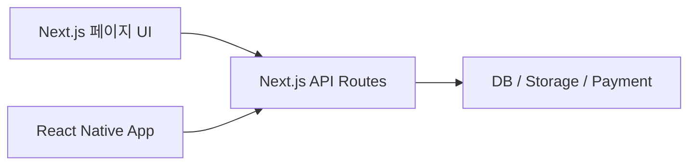

# CRUSTORY 개발환경

브랜드·기능 기획은 [기획원문.md](기획원문.md)를 참고한다.  
이 문서는 **기술 스택과 역할 분리**만 정리한다.

## 목표

- 웹(SEO·브랜드·쇼핑몰)을 **Next.js**로 구축한다.
- 페이지 UI와 API를 **하나의 Next 프로젝트**에서 만든다.
- 이후 **React Native** 앱은 같은 API를 호출해 전환한다. (UI는 플랫폼별로 새로 작성)

## 스택

| 구분 | 선택 | 역할 |
|------|------|------|
| 웹 + API | Next.js (App Router) | 페이지 렌더(SEO) + `app/api` 백엔드 |
| 데이터·파일·결제 | 외부 서비스 (추후 확정) | DB, Storage, 결제사 연동 |
| 앱 | React Native (추후) | 네이티브 UI, 공용 API 재사용 |

초기에는 **별도 Nest/Express 서버 없이** Next 단일 프로젝트로 시작한다.  
규모가 커지면 API만 분리할 수 있도록, 비즈니스 로직은 처음부터 API(서버) 쪽에 둔다.

## 구조

- **Next.js 페이지**: HOME, OUR STORY, MEET RUNIE, SHOP 등 화면 + SEO용 HTML
- **Next.js API**: 상품·주문·결제 승인 등 서버 로직 (웹·앱 공용)
- **React Native**: 나중에 추가. Next HTML이 아니라 **같은 API**를 호출
- **DB / Storage / Payment**: Next 밖 서비스. API Routes에서만 연결

## 규칙

### 할 것

- 상품·재고·주문·결제 승인은 **API(서버)** 에 둔다.
- 웹과 앱이 같은 엔드포인트를 쓰도록 API를 설계한다.
- 결제 시크릿 키는 **서버 환경변수**에서만 읽는다.

### 하지 말 것

- 주문·결제 로직을 페이지 컴포넌트에만 넣지 않는다. (앱에서 재사용 불가)
- 브라우저·앱 클라이언트에서 결제 시크릿을 호출하지 않는다.
- “웹만 되면 된다”며 API 없이 UI에 데이터를 하드코딩해 두지 않는다. (프로토타입 목업은 가능하나, 실서비스 경로와 분리)

## 프로토타입

지금은 Next 한 프로젝트로 화면 + API 뼈대를 만든다.  
RN 앱·별도 백엔드 서버는 범위 밖이다.
